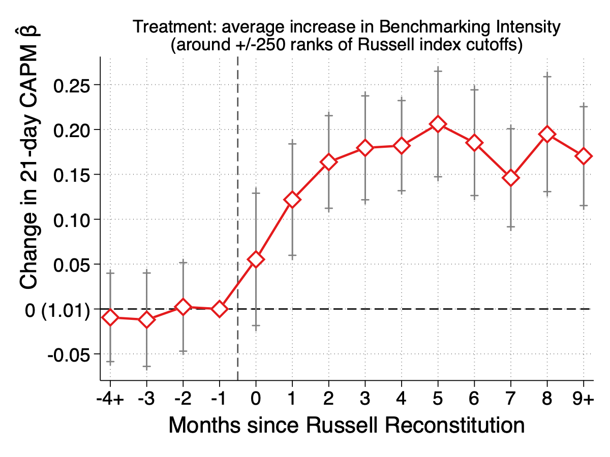
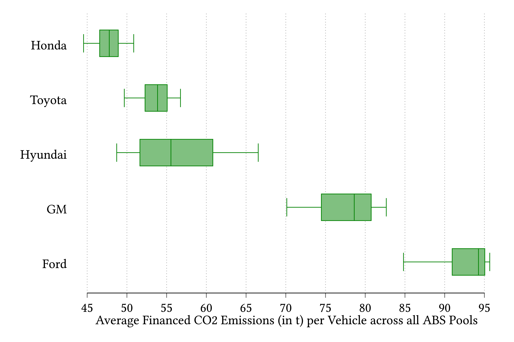
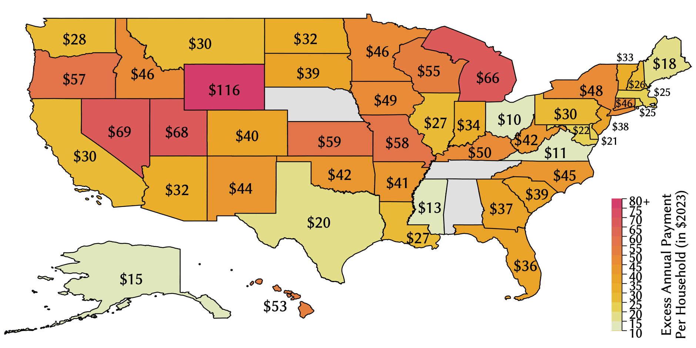
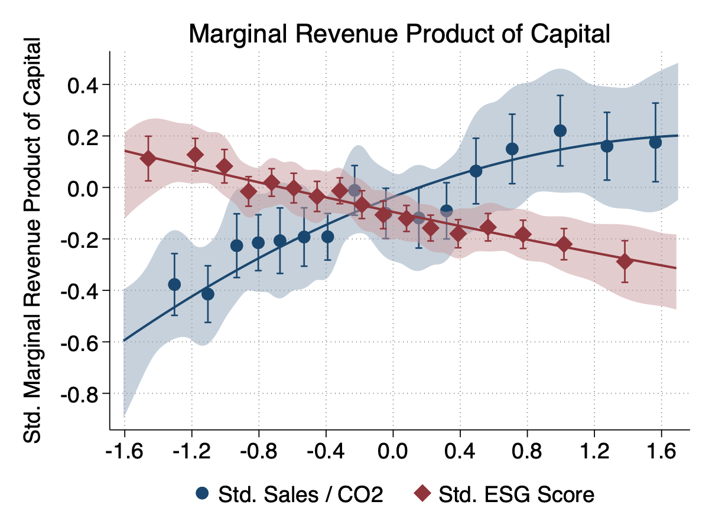

<head>	
	<meta name="viewport" content="width=device-width, initial-scale=1">
	

	<link rel="shortcut icon" type="image/x-icon" href="favicon.ico?">
</head>

	

	
	

	

		
 
		<b>
		Hi, I'm Christian Kontz. I'm a Ph.D. candidate in Finance at the Stanford Graduate School of Business.
		</b>
		 
		 
		My research lies at the intersection of empirical Corporate Finance and Asset Pricing, exploring how financial markets and corporate decision-making interact. 
		<!-- Specifically, I study how financial market structures, such as the rise of passive investing and sustainable investing, affect the cost of capital and corporate investment decisions.  -->
 
 

	<!-- CV (Document Icon) -->
	<!-- <a href="/files/ChristianKontzCV.pdf" target="_blank" class="icon-btn" aria-label="Download CV"> -->
		<!-- <svg xmlns="http://www.w3.org/2000/svg" viewBox="0 0 24 24" width="22" height="22" fill="white"> -->
			<!-- <path d="M6 2a2 2 0 0 0-2 2v16a2  -->
			<!-- 2 0 0 0 2 2h12a2 2 0 0 0 2-2V8l-6-6H6z"/> -->
		<!-- </svg> -->
	<!-- </a> -->
	<!-- CV (text instead of icon) -->
	<a href="/files/ChristianKontzCV.pdf" target="_blank" class="icon-btn" aria-label="Download CV">
		CV
	</a>
	<!-- Email -->
	<a href="mailto:ckontz@stanford.edu" class="icon-btn" aria-label="Email Christian Kontz">
		<svg xmlns="http://www.w3.org/2000/svg" viewBox="0 0 24 24" width="22" height="22" fill="white">
			<path d="M20 4H4c-1.1 0-2 .9-2 
			2v12c0 1.1.9 2 2 2h16c1.1 0 
			2-.9 2-2V6c0-1.1-.9-2-2-2zm0 
			4l-8 5-8-5V6l8 5 8-5v2z"/>
		</svg>
	</a>
	<!-- Google Scholar -->
	<a href="https://scholar.google.com/citations?user=YFuScPwAAAAJ&hl" target="_blank" class="icon-btn" aria-label="Google Scholar">
		<svg xmlns="http://www.w3.org/2000/svg" viewBox="0 0 48 48" width="22" height="22" fill="white">
			<path d="M24 4L4 24l7.5 7.5L24 19l12.5 12.5L44 24z"/>
			<path d="M24 29c-6.08 0-11 4.92-11 11h6c0-2.76 2.24-5 5-5s5 2.24 5 5h6c0-6.08-4.92-11-11-11z"/>
		</svg>
	</a>
	<!-- LinkedIn -->
	<a href="https://www.linkedin.com/in/christian-kontz-a16465141/" target="_blank" class="icon-btn" aria-label="LinkedIn">
		<svg xmlns="http://www.w3.org/2000/svg" viewBox="0 0 24 24" width="22" height="22" fill="white">
			<path d="M4.98 3.5C4.98 4.88 3.87 6 2.5 6S0 
			4.88 0 3.5 1.12 1 2.5 1s2.48 1.12 
			2.48 2.5zM.5 8.5h4V24h-4V8.5zM8.5 
			8.5h3.8v2.1h.05c.53-1 1.84-2.05 
			3.79-2.05 4.05 0 4.8 2.67 4.8 
			6.14V24h-4v-7.6c0-1.81-.03-4.14-2.52-4.14-2.52 
			0-2.9 1.96-2.9 4v7.74h-4V8.5z"/>
		</svg>
	</a>
	<!-- Twitter (X) -->
	<a href="https://twitter.com/ChristianKontz" target="_blank" class="icon-btn" aria-label="Twitter">
		<svg xmlns="http://www.w3.org/2000/svg" viewBox="0 0 24 24" width="22" height="22" fill="white">
			<path d="M23.3 4.8c-.8.4-1.6.6-2.5.8.9-.6 
			1.6-1.4 1.9-2.5-.9.5-1.8.9-2.8 
			1.1C18.9 3.4 17.7 3 16.5 3c-2.5 
			0-4.5 2-4.5 4.5 0 .3 0 .7.1 
			1C8 8.3 4.3 6.4 1.7 3.3c-.4.6-.6 
			1.4-.6 2.2 0 1.5.8 2.9 2 
			3.7-.7 0-1.3-.2-1.9-.5v.1c0 
			2.1 1.5 3.9 3.5 4.3-.4.1-.8.2-1.3.2-.3 
			0-.6 0-.9-.1.6 1.9 2.4 3.3 4.6 
			3.4-1.6 1.3-3.6 2-5.7 2-.4 
			0-.7 0-1.1-.1 2 1.3 4.4 2.1 6.9 
			2.1 8.3 0 12.8-6.9 12.8-12.8v-.6c.9-.6 
			1.7-1.4 2.3-2.3z"/>
		</svg>
	</a>

	

<!-- PAPER SECTION -->

<h3 id="research" class="section-title">Working Papers</h3>

<!-- Paper 1 : The Real Cost of Benchmarking-->

	

		 
			
		<a>
			The Real Cost of Benchmarking
		</a>
		(with <a href="https://shanson93.github.io/">Sebastian Hanson</a>)
		 
			<!-- visible even when collapsed -->
			
				FIRS PhD Paper Prize ’25
				SFS Cavalcade PhD Student Award ’25
			
		
	

	

		

			

				<a href="/files/Kontz_Hanson_TheRealCostOfBenchmarking.pdf" target="_blank" style="font-size:20px;">[Draft]</a>&#160;
				<a href="https://ssrn.com/abstract=4884602" target="_blank" style="font-size:20px;">[SSRN]</a>&#160;
				<a href="#" onclick="show('kontzhanson2024');" style="font-size:20px;">[BibTex]</a>
				
 
@techreport{kontzhanson2024, 
&nbsp;&nbsp;&nbsp;title={The Real Cost of Benchmarking}, 
&nbsp;&nbsp;&nbsp;author={Kontz, Christian and Hanson, Sebastian}, 
&nbsp;&nbsp;&nbsp;type={Working Paper}, 
&nbsp;&nbsp;&nbsp;institution={Stanford University}, 
&nbsp;&nbsp;&nbsp;year={2024}, 
}
				

				 
				<h4 style="color:black;font-size:16px;">Abstract:</h4>
				

					This paper provides causal evidence that asset price distortions caused by benchmarking affect corporate investment decisions. We document that the rise in benchmark-linked investing over the past two decades fundamentally changed the cross-section of CAPM &beta;s. Exploiting exogenous variation from Russell index reconstitutions, we show inclusion in benchmark indices leads to higher CAPM &beta;s, with larger effects observed among stocks facing greater benchmarking intensity. Firm managers interpret the resulting higher CAPM &beta; as an increase in their firm's cost of capital, leading them to reduce investment. Six years after inclusion, firms experience 7.1% and 8.4% declines in physical and intangible capital, respectively. Supporting evidence shows that benchmark-inclusion similarly increases the perceived cost of equity among stock analysts and regulators. We find consistent results at the industry level. Industries which experienced greater increases in CAPM &beta;s due to benchmarking accumulated less capital over the past two decades. Moreover, benchmarking creates excess dispersion in the cost of capital within industries, causing inefficient capital allocation across firms. The rise in CAPM &beta;s largely offset the decline in the risk-free rate over the past decades and can explain 57% of the “missing investment” puzzle.
				

				

					<i><b>Selected Presentations:</b> AFA Annual Meeting 2026*, Carey Finance Conference*, SFS Cavalcade NA 2025, FIRS 2025, Four Corners/FMRC Conference on Indexing, Investment Company Institute, Northeastern University Finance Conference 2025, UIC Finance Conference 2025c, Citadelc 
					 
					(* scheduled, c co-author)</i>
				

				

					<i><b>Awards:</b>  SFS Cavalcade PhD Student Award, FIRS Conference 2025 Prize for PhD Students</i>
				

			

			

				
			

		

	

<!-- Paper 2 : Do ESG Investors Care About Carbon Emissions?-->

	

		
			
				Do ESG Investors Care About Carbon Emissions? Evidence From Securitized Auto Loans			
			
			<!-- visible even when collapsed -->
			
				UN PRI Best PhD Paper ’25
				GRASFI Best PhD Paper ’24
				FIRS PhD Paper Prize ’24
				Myron Scholes PhD Prize ’24
			
		
	

	

		

			

				<a href="/files/KONTZ_DoESGInvestorsCareAboutCarbonEmissions.pdf" target="_blank" style="font-size:20px;">[Draft]</a>&#160;
				<a href="https://ssrn.com/abstract=4357312" target="_blank" style="font-size:20px;">[SSRN]</a>&#160;
				<a href="#" onclick="show('kontz2023esg');" style="font-size:20px;">[BibTex]</a>
				
 
@techreport{kontz2023esg, 
&nbsp;&nbsp;&nbsp;title={Do ESG Investors Care About Carbon Emissions? Evidence From Securitized Auto Loans}, 
&nbsp;&nbsp;&nbsp;author={Kontz, Christian}, 
&nbsp;&nbsp;&nbsp;type={Working Paper}, 
&nbsp;&nbsp;&nbsp;institution={Stanford University}, 
&nbsp;&nbsp;&nbsp;year={2023}, 
} 
				

				<h4 style="color:black;font-size:16px;">Abstract:</h4>
				

					The ESG convenience yield in auto loan securitizations rose from 0.03% in 2017 to 0.54% in 2022. Consumers financing vehicles through captive lenders benefit from lower borrowing costs. However, the focus on ESG scores also lowers the cost of capital for high-emissions vehicles. ESG funds allocate more capital to securitizations from issuers with high ESG scores even when they finance high-emissions vehicles. A model of subjective beliefs in which investors heuristically infer CO2 emissions from ESG scores can explain the observed effects. These findings suggest that ESG investing affects real quantities but does not raise the cost of emitting CO2.
				

				

					<i><b>Selected Presentations:</b> FIRS Conference 2024, OU-RFS Climate and Energy Conference 2024, GRASFI Conference 2024, SoFiE Conference 2024, CEPR-ESSEC-Luxembourg Conference on Sustainable Financial Intermediation, Harvard Climate Economics Workshop, UC Santa Cruz</i>
				

				

					<i><b>Awards:</b>  UN PRI Best PhD Student Paper Award 2025, FIRS Conference 2024 Prize for PhD Students, GRASFI Conference 2024 Best PhD Paper Award, Myron S. Scholes PhD Prize 2024, Finalist FIASI Fixed Income Competition 2024</i>
				

			

			

				
			

		

	

<h3 id="research" class="section-title">Work-in-Progress</h3>

<!-- Paper 3: Markets to Meters -->

	
From Markets to Meters: How Index Investing Affects Electricity Prices

	

		

			

				<h4 style="color:black;font-size:16px;">Abstract:</h4>
				

					

						This paper documents that index investing distort risk measures used in regulatory price-setting. 
						Exploiting quasi-experimental variation from Russell index reconstitutions, we find that a utility's inclusion in a more heavily benchmarked index inflates its CAPM &beta. 
						We then show this distortion leads regulators to authorize higher returns on equity, which are ultimately passed on to consumers. 
						This mechanism has substantial aggregate consequences, generating over $85 billion in total economic costs from 1998-2018. 
						Evidence from the regulated railroad industry confirms the mechanism's external validity, highlighting a significant, previously undocumented consequence of modern financial market structure on regulated industries.
					

				

				<a href="#/" style="font-size:15px;">[Preliminary draft available upon request]</a>
			

			

				
			

		

	

<!-- Paper 4: ESG Induced Capital Misallocation -->

	
ESG Induced Capital Misallocation: is ESG Doing Good, by Doing Well?

	

		

			

				<h4 style="color:black;font-size:16px;">Abstract:</h4>
				

					

						This paper studies the impact of environmental, social, and governance (ESG) investing on the real economy. Using within industry-year variation, I find that 1.) firms with high ESG ratings have low marginal revenue products of capital (MRPK), while, 2.) firms with high sales per tCO2 emission have high MRPKs. This implies that reallocating capital to firms with high ESG ratings lowers allocative efficiency while reallocating capital to greener firms increases it. Motivated by these facts, I estimate a dynamic investment model featuring convenience yields on ESG assets and a CO2 externality to explore the implications of ESG investing for capital misallocation and climate change mitigation.
					

				

				<a href="#/" style="font-size:15px;">[Draft coming soon]</a>
			

			

				
			

		

	

<!-- Paper 5: The Cross-Section of Prices  -->

	
The Cross-Section of Prices
	 (with <a href="https://gsb-faculty.stanford.edu/hanno-lustig/">Hanno Lustig</a> and Miguel Chumbo)

<!-- BIBTEX SCRIPTS -->

