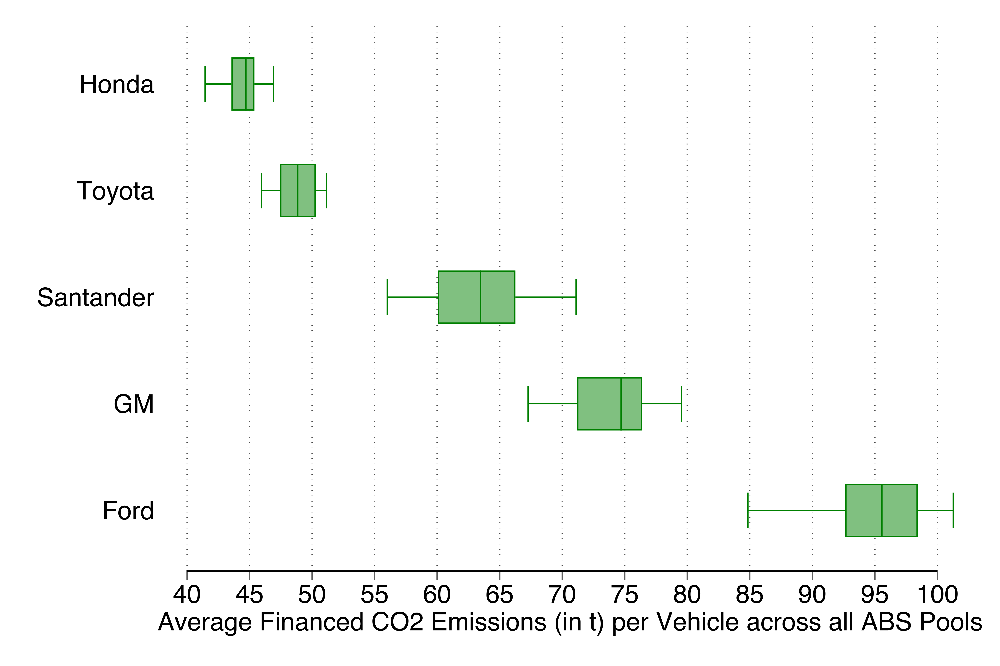

## Working Papers
 

#### <a href="../files/Kontz_ESG_auto_ABS.pdf"> Do ESG investors care about carbon emissions? Evidence from securitized auto loans</a>

**Abstract:**

 

Over the last decade, assets under management using environmental, social, and governance (ESG) criteria have increased tenfold. This paper shows that financial markets <i>do not</i> price differences in CO2 emissions of auto loans despite the rise of ESG investing. I argue that securitized auto loans present a clean empirical setting to measure ESG preferences in price and quantity data. I find that securities with high-emission pools have, on average, 5 basis points (11%) lower cost of capital. Mutual funds marketed as ESG (i) hold positions across the full distribution of CO2 emissions and (ii) invest more in higher-emission deals. Neither (i) nor (ii) are consistent with common ESG strategies.

<a href="https://ssrn.com/abstract=4357312">[SSRN]</a>

 
 

